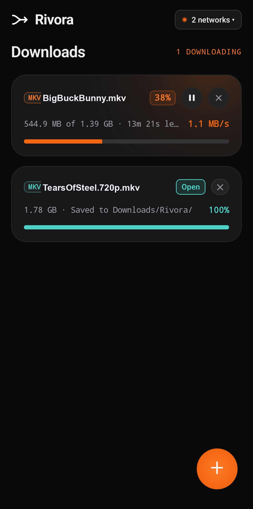
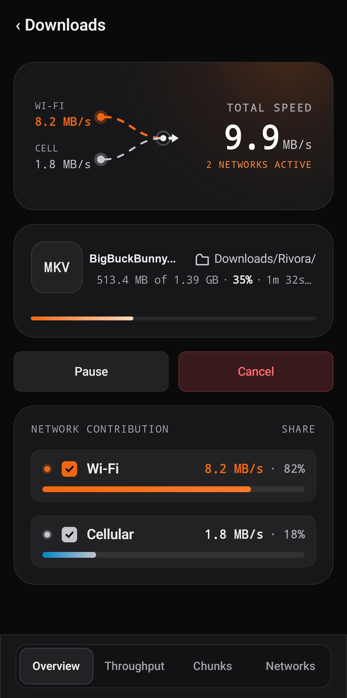
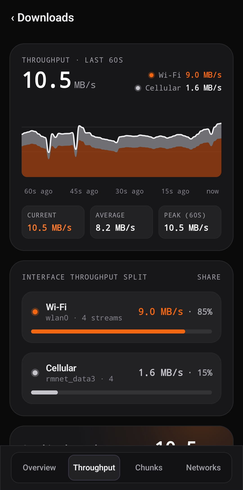
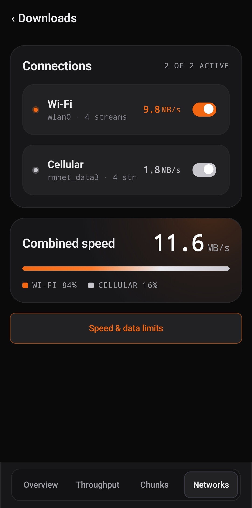
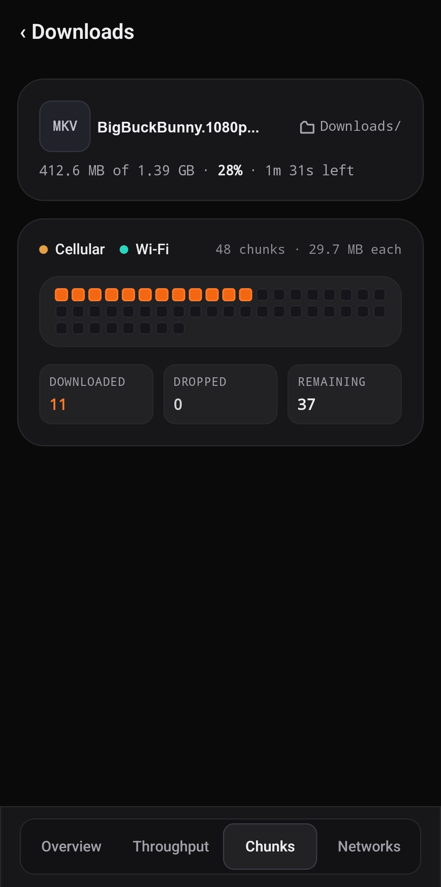

<p align="center">
  
</p>

<h1 align="center">Rivora</h1>

<p align="center">
  <b>High-performance multi-network download manager for Android.</b><br />
  Aggregates concurrent Wi-Fi and Cellular interfaces into a unified high-speed pipeline.
</p>

<p align="center">
  <a href="https://github.com/JishnuPG-tech/Rivora/releases"></a>
  <a href="https://developer.android.com/about/versions/nougat"></a>
  <a href="https://kotlinlang.org"></a>
  <a href="https://developer.android.com/jetpack/compose"></a>
  <a href="LICENSE"></a>
</p>

---

## Overview

**Rivora** is a high-performance Android download manager and the mobile counterpart to **Plexoo (Plexo)**. Engineered to overcome single-link mobile bandwidth ceilings, Rivora binds HTTP sockets directly to distinct physical network interfaces (concurrent Wi-Fi and 4G/5G Cellular data paths) to aggregate throughput, enforce strict link pre-validation, and render real-time chunk telemetry.

---

## Interface & Telemetry Showcase

<p align="center">
  
  &nbsp;&nbsp;
  
  &nbsp;&nbsp;
  
</p>
<p align="center">
  <i>(Left) Main Downloads Dashboard &nbsp;&bull;&nbsp; (Center) Dual Network Bonding Overview &nbsp;&bull;&nbsp; (Right) 60-Second Real-Time Throughput Graph</i>
</p>

<br />

<p align="center">
  
  &nbsp;&nbsp;&nbsp;&nbsp;
  
</p>
<p align="center">
  <i>(Left) Hardware Interface Controls & Combined Gauge &nbsp;&bull;&nbsp; (Right) 48-Part Liquid Worker Matrix</i>
</p>

---

## Key Capabilities

### ⚡ Multi-Network Stream Bonding
Binds multi-part socket workers directly to separate physical interfaces (`wlan0` and cellular modem data interfaces such as `rmnet_data*`). Transfers execute in parallel across both pathways, combining throughput into a single high-speed stream.

### 📊 Real-Time Throughput Telemetry
Maintains a 60-second sliding window telemetry pipeline measuring instantaneous speed, moving average, and peak transfer rates. A stacked area chart visually delineates interface contribution splits (Wi-Fi vs. Cellular ratios).

### 🧩 48-Part Liquid Chunk Matrix
Dynamically partitions files into variable-sized chunk segments managed by concurrent worker coroutines. A custom canvas rendering engine reflects byte-level progress, downloaded blocks, and segment states in real-time.

### 💾 Persistent Resumable Storage Engine
Streams payload data directly into pre-allocated file descriptors using random-access seek-and-write operations. Chunk offsets and completion bitmaps are persistently tracked on disk, ensuring instant pause and zero-loss resume after network transitions or app restarts.

### 🔍 Real-Time Link Pre-Validation
Probes remote URLs prior to queuing to confirm direct download endpoints (videos, audio, archives, disk images, documents, and APKs). Prevents accidental downloads of HTML error pages or dead links.

### 🛡️ Background Foreground Service
Runs as an Android foreground service with priority wake-locks and notification telemetry, displaying live download speed, remaining time, and instant pause/cancel controls directly from the lock screen.

---

## Technical Architecture

```
┌────────────────────────────────────────────────────────┐
│             Jetpack Compose UI (Material 3)            │
│    Dashboard  •  Throughput Chart  •  Chunk Matrix     │
└───────────────────────────▲────────────────────────────┘
                            │ StateFlow / Coroutines
┌───────────────────────────┴────────────────────────────┐
│              Bonding Engine Orchestrator               │
│   Chunk Allocator  •  Speed Monitor  •  Storage Engine │
└─────────────▲────────────────────────────▲─────────────┘
              │ Direct Socket Binding      │ Direct Socket Binding
┌─────────────┴──────────────┐┌────────────┴─────────────┐
│     Wi-Fi Interface        ││    Cellular Interface    │
│         (wlan0)            ││       (rmnet_data*)      │
└────────────────────────────┘└──────────────────────────┘
```

| Component | Implementation |
|---|---|
| **Target Platform** | Android 7.0+ (API Level 24+) |
| **Language** | Kotlin 2.0 |
| **UI Framework** | Jetpack Compose (Material 3, Canvas Graphics) |
| **Networking** | Multi-Interface OkHttp 4.12+ with direct socket routing |
| **Concurrency** | Kotlin Coroutines & `StateFlow` reactive pipelines |
| **Persistence** | Jetpack DataStore / Room & Random-Access File I/O |
| **Build System** | Gradle (Kotlin DSL) |

---

## Downloads & Releases

Pre-built APKs are available on the [GitHub Releases](https://github.com/JishnuPG-tech/Rivora/releases) page:

* **Official Release (`Rivora-v1.1.3.apk`)**: Production binary, zip-aligned, ProGuard-optimized, and signed for daily use.
* **Debug APK (`Rivora-v1.1.3-debug.apk`)**: Development binary with debug symbols and verbose logcat output enabled.

---

## Building from Source

### Prerequisites
* Android Studio Ladybug (2024.2+) or newer
* Android SDK 36
* Java Development Kit (JDK) 17+

### Build Commands
```bash
# Clone the repository
git clone https://github.com/JishnuPG-tech/Rivora.git
cd Rivora

# Build Release and Debug APKs
./gradlew assembleRelease assembleDebug
```

The resulting binaries will be located at:
* `app/build/outputs/apk/release/app-release.apk`
* `app/build/outputs/apk/debug/app-debug.apk`

### Install via ADB
```bash
adb install -r app/build/outputs/apk/release/app-release.apk
```

---

## Early Preview Notice

This is an active preview release (**v1.1.3**). Testing has been conducted across real physical Android hardware with dual active network interfaces. Given varying OEM background throttling behaviors and carrier network policies, please report any edge cases or unexpected behaviors via [GitHub Issues](https://github.com/JishnuPG-tech/Rivora/issues).

---

## License

Rivora is open-source software licensed under the [Apache License 2.0](LICENSE).
